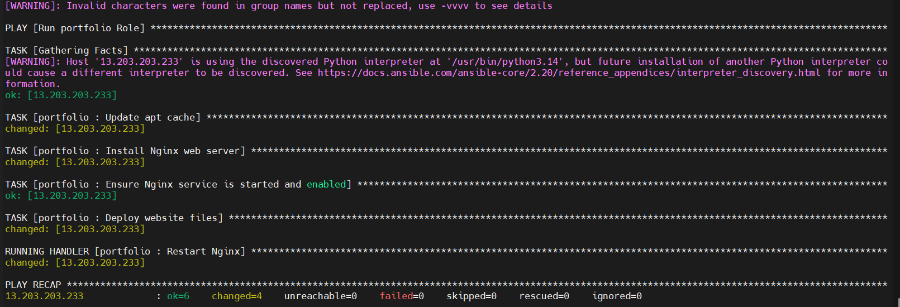
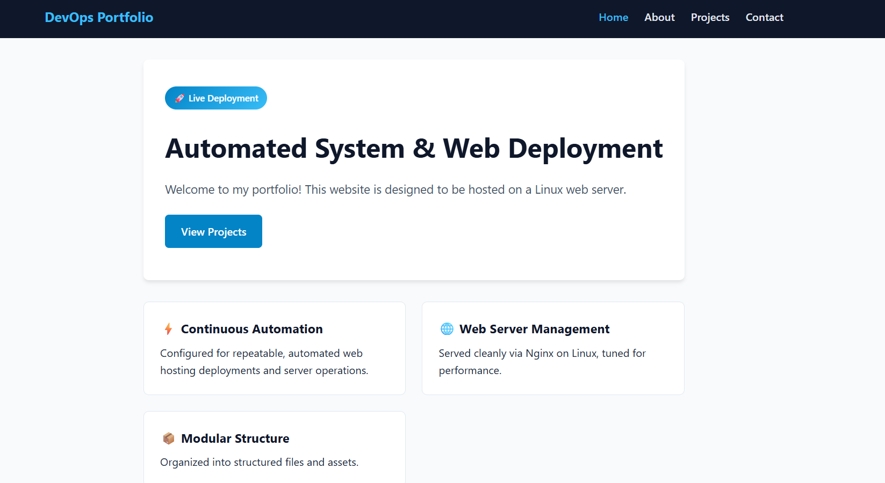

# Ansible Automated Web Hosting on AWS EC2

## Project Overview

This project demonstrates automated static website hosting on AWS EC2 using Ansible Roles and Nginx.

Two Ubuntu EC2 instances are used: one as the Ansible Control Node and another as the Portfolio Web Server. SSH key-based authentication is configured between the servers, allowing the Ansible Control Node to manage the web server without requiring an SSH password for each connection.

Ansible automates Nginx installation, website file deployment, and service management through a reusable role-based structure.


### Deployment Workflow

1. Launch Ubuntu EC2 instances on AWS.
2. Configure SSH key-based authentication.
3. Create an Ansible inventory to identify the managed server.
4. Create an Ansible role to organize deployment tasks.
5. Update the APT package cache and install Nginx.
6. Ensure the Nginx service is started and enabled.
7. Deploy static website files to the Nginx web root.
8. Use an Ansible handler to restart Nginx when website files are updated.
9. Access the hosted website through the EC2 public IP address.

> **Scope:** This project automates web-server setup and website deployment on an existing EC2 instance. EC2 instance provisioning is performed separately and is not automated by the current playbook.

## Technologies Used

- AWS EC2
- Ubuntu Server
- Ansible
- Ansible Roles
- Nginx
- SSH key-based authentication
- YAML
- HTML5
- CSS3

## Project Structure

```text
ansible-project/
│
├── inventory.ini
├── README.md
├── site.yml
│
├── roles/
│   └── portfolio/
│       ├── README.md
│       ├── defaults/
│       │   └── main.yml
│       ├── files/
│       │   └── portfolio/
│       │       ├── about.html
│       │       ├── contact.html
│       │       ├── index.html
│       │       ├── projects.html
│       │       └── style.css
│       ├── handlers/
│       │   └── main.yml
│       ├── meta/
│       │   └── main.yml
│       ├── tasks/
│       │   └── main.yml
│       ├── templates/
│       ├── tests/
│       │   ├── inventory
│       │   └── test.yml
│       └── vars/
│           └── main.yml
│
└── screenshots/
    ├── ansible-playbook-execution.png
    ├── aws-ec2-instances.png
    └── website-live-deployment.png
```

## Ansible Role Explanation

The project uses an Ansible Galaxy role named `portfolio` to organize the automation tasks.

| Directory / File | Purpose |
|---|---|
| `inventory.ini` | Defines the managed EC2 server |
| `site.yml` | Main playbook that executes the portfolio role |
| `tasks/main.yml` | Updates the APT cache, installs Nginx, deploys website files, and manages the service |
| `handlers/main.yml` | Restarts Nginx when notified by a task |
| `files/portfolio/` | Contains the static website HTML and CSS files |
| `defaults/main.yml` | Stores default role variables |
| `vars/main.yml` | Stores role-specific variables |
| `templates/` | Reserved for Jinja2 templates |
| `meta/main.yml` | Contains role metadata and dependencies |
| `tests/` | Contains sample role testing files |

## SSH Key-Based Authentication

SSH key-based authentication was configured.

This allows the control node to establish SSH connections to the managed node without entering an SSH account password for every connection.

The authentication setup involved:

1. Generating an SSH key pair on the Node.
2. Adding the public key to the managed server's `authorized_keys` file.
3. Verifying passwordless SSH connectivity.
4. Using the established SSH connection to execute Ansible playbooks.

**Note:** Private SSH keys are not included in this repository.

## Deployment Configuration

### 1. Inventory Configuration

The inventory file identifies the EC2 instance managed by Ansible.

Example:

```ini
[portfolio_webserver]
YOUR_EC2_PUBLIC_IP ansible_user=ubuntu
```

Configure the SSH private key through your SSH configuration or specify `ansible_ssh_private_key_file` in the inventory if required.

Make sure the inventory group name matches the `hosts` value in `site.yml`.

### 2. Main Playbook

The `site.yml` file calls the portfolio role.

```yaml
---
- name: Run portfolio Role
  hosts: ansible-portfolio
  become: yes

  roles:
    - portfolio
```

### 3. Deployment Tasks

The `roles/portfolio/tasks/main.yml` file performs the following operations:

- Updates the APT package cache.
- Installs the Nginx web server.
- Starts and enables the Nginx service.
- Copies website files from the role's `files/portfolio/` directory to `/var/www/html/`.
- Notifies the Nginx handler when website files change.

### 4. Handler Configuration

The `roles/portfolio/handlers/main.yml` file defines a handler that restarts Nginx when notified by the deployment task.

```yaml
---
- name: Restart Nginx
  service:
    name: nginx
    state: restarted
```

## Running the Project

Run the following commands from the project directory on the Ansible Control Node.

### Step 1: Test SSH Connectivity

```bash
ssh ubuntu@YOUR_EC2_PUBLIC_IP
```

Verify that the SSH connection works using your configured key-based authentication, then exit the remote session.

### Step 2: Test Ansible Connectivity

```bash
ansible portfolio_webserver -i inventory.ini -m ping
```

Expected result:

```text
SUCCESS => {
    "changed": false,
    "ping": "pong"
}
```

### Step 3: Check Playbook Syntax

```bash
ansible-playbook -i inventory.ini site.yml --syntax-check
```

### Step 4: Execute the Playbook

```bash
ansible-playbook -i inventory.ini site.yml
```

Ansible connects to the managed EC2 instance and performs the deployment tasks.

## Access the Website

After successful execution, access the website using the Portfolio Web Server's public IP address:

```text
http://YOUR_EC2_PUBLIC_IP
```

The website contains the following pages:

- Home — `index.html`
- About — `about.html`
- Projects — `projects.html`
- Contact — `contact.html`

Nginx serves the website files from `/var/www/html/`.

## Screenshots

### 1. Ansible Playbook Execution

Shows the successful execution of the Ansible playbook, including Nginx installation, website deployment, and handler execution.



### 2. Live Website Deployment

Shows the static portfolio website hosted on the AWS EC2 instance and accessed through its public IP address.



## Author

**Mansoor**
